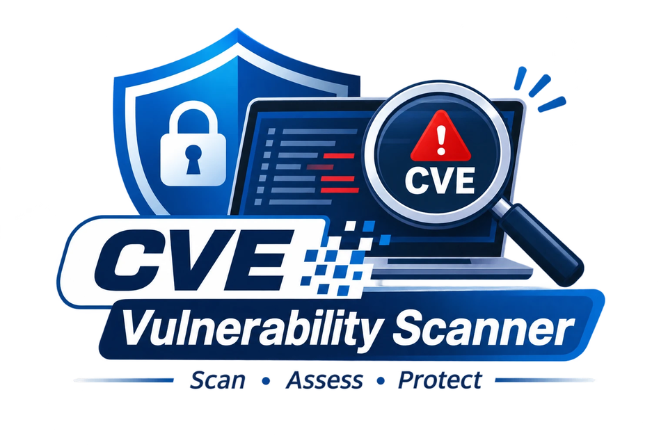
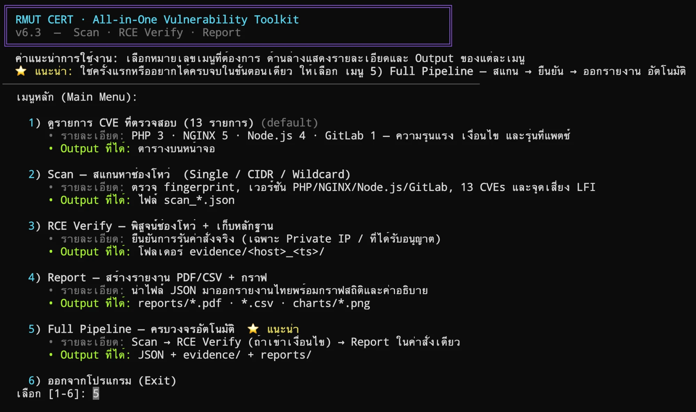

<div align="center">



# 🛡️ Security Audit Toolkit (RMUT CERT)

**เครื่องมือตรวจหาช่องโหว่ + ยืนยันผล + ออกรายงาน แบบครบในตัวเดียว สำหรับทีม CERT**

[](LICENSE)
[](https://www.python.org/)
[](#%EF%B8%8F-ข้อควรระวังด้านกฎหมายและการใช้งาน)

เครื่องมือไฟล์เดียว ติดตั้งง่าย ใช้โดยทีม CERT ของมหาวิทยาลัยเพื่อ **สแกน → ยืนยันช่องโหว่ → ออกรายงาน** บนระบบที่ **ได้รับอนุญาตให้ทดสอบเท่านั้น**

📑 **[สไลด์นำเสนอ (security_audit_toolkit.pdf)](security_audit_toolkit.pdf)** — สรุปการใช้งานแบบรวดเร็ว

</div>

---

> ## ⚠️ ข้อควรระวังด้านกฎหมายและการใช้งาน
>
> เครื่องมือนี้ยิงคำขอไปยังเป้าหมายจริง และสามารถทดลองยืนยันช่องโหว่ (RCE) ได้ **ใช้ได้เฉพาะกับระบบที่คุณเป็นเจ้าของ หรือได้รับอนุญาตเป็นลายลักษณ์อักษรให้ทดสอบเท่านั้น** การสแกนหรือโจมตีระบบที่ไม่ได้รับอนุญาตผิดกฎหมายในเกือบทุกประเทศ
>
> - โหมด `--pipeline` (ทดสอบเจาะจริง) **บังคับ** ต้องใส่ธง `--i-own-this-target` เพื่อยืนยันความเป็นเจ้าของ
> - ผู้ใช้รับผิดชอบการใช้งานเองทั้งหมด ซอฟต์แวร์ให้มา **"ตามสภาพ" ไม่มีการรับประกัน** (ดู [สัญญาอนุญาต MIT](LICENSE))

---

## 📋 สารบัญ

- [เครื่องมือนี้ทำอะไรได้](#-เครื่องมือนี้ทำอะไรได้)
- [สิ่งที่ต้องมีก่อน](#-สิ่งที่ต้องมีก่อน)
- [ติดตั้ง (ทำครั้งเดียว)](#-ติดตั้ง-ทำครั้งเดียว)
- [เริ่มใช้งาน](#-เริ่มใช้งาน)
- [หน้าต่างเมนูโต้ตอบ (Interactive Menu)](#-หน้าต่างเมนูโต้ตอบ-interactive-menu)
- [ไฟล์ผลลัพธ์ที่ได้](#-ไฟล์ผลลัพธ์ที่ได้)
- [แฟ้มหลักฐานและเอกสารรายงาน](#-แฟ้มหลักฐานและเอกสารรายงาน)
- [การให้คะแนนความเสี่ยง](#-การให้คะแนนความเสี่ยง)
- [คำถามพบบ่อย](#-คำถามพบบ่อย)
- [ร่วมพัฒนา](#-ร่วมพัฒนา)
- [ติดต่อ](#-ติดต่อ)
- [สัญญาอนุญาต](#-สัญญาอนุญาต)

## ✨ เครื่องมือนี้ทำอะไรได้

- **🔍 สแกนช่องโหว่** — ตรวจ 13 CVE ครอบคลุม **PHP (3)**, **NGINX (5)**, **Node.js (4)**, **GitLab (1)** พร้อมตรวจจับสัญญาณ LFI / path traversal
- **🎯 เลือกเป้าหมายได้หลายแบบ** — โฮสต์เดียว, ช่วง IP (CIDR), ค้นหาซับโดเมน (wildcard), หรืออ่านจากไฟล์รายชื่อ (CSV/TXT)
- **🧪 ยืนยันช่องโหว่ RCE** — ตรวจแบบปลอดภัย พร้อมเก็บ **หลักฐานตามหลัก chain-of-custody** (`transcript.log`, `metadata.json`, `summary.json`, `rce_proof.txt`)
- **📊 ออกรายงานอัตโนมัติ** — ไฟล์ **PDF** (6 บท) + **CSV/Excel** + **กราฟ 4 รูป (PNG)** พร้อมดัชนีความเสี่ยงรายโฮสต์ตามมาตรฐาน **CVSS v3.1**
- **🔗 โหมดครบวงจร (Pipeline)** — สแกน → ยืนยัน → ออกรายงาน ในคำสั่งเดียว
- **🖥️ ใช้ได้ 2 แบบ** — เมนูโต้ตอบ หรือพิมพ์คำสั่ง (CLI) สำหรับทำสคริปต์
- **🧩 ไลบรารีเสริมไม่มีก็ทำงานได้** — ถ้าไม่มี `dnspython`, `reportlab`, `matplotlib` โปรแกรมจะข้ามฟีเจอร์นั้นให้เองโดยไม่ล้ม
- **🧷 ปลอดภัยกับไฟล์เดิม** — ทุกไฟล์ผลลัพธ์มี timestamp ต่อท้าย ไม่เขียนทับของเก่า

## ✅ สิ่งที่ต้องมีก่อน

- **Python 3.9 ขึ้นไป** (ตรวจเวอร์ชันด้วย `python3 --version` บน Windows ใช้ `python --version`)
- `pip` สำหรับติดตั้งไลบรารี
- สิทธิ์/หนังสืออนุญาตให้ทดสอบระบบเป้าหมาย

### 🖥️ เปิดหน้าต่างพิมพ์คำสั่ง (Terminal) ตามระบบของคุณ

| ระบบปฏิบัติการ | เปิดด้วย | คำสั่ง Python ที่ใช้ |
|----------------|----------|---------------------|
| **Windows** | **Windows Terminal** (ติดตั้งฟรีจาก **Microsoft Store**) หรือ **Command Prompt** (`cmd`) | `python` |
| **macOS** | แอป **Terminal** | `python3` |
| **Linux** | **Terminal** ของเครื่อง | `python3` |

> 💡 **ผู้ใช้ Windows:** คำสั่งทุกคำสั่งในคู่มือนี้ ให้เปลี่ยน `python3` เป็น `python`
> เช่น `python security_audit_toolkit.py` — ที่เหลือเหมือนกันทุกอย่าง

## 📦 ติดตั้ง (ทำครั้งเดียว)

**ขั้นที่ 1 — ติดตั้ง Python 3.9 ขึ้นไป** (ถ้ามีอยู่แล้ว ข้ามไปขั้นที่ 2)

- **Windows:** โหลดตัวติดตั้งจาก [python.org/downloads](https://www.python.org/downloads/) กดเปิดไฟล์ที่โหลดมา แล้ว **ติ๊กถูกที่ช่อง `Add python.exe to PATH` ก่อนกด Install** (สำคัญมาก ถ้าไม่ติ๊ก คำสั่ง `python` จะใช้ไม่ได้) — หรือติดตั้งจาก **Microsoft Store** โดยค้นหาคำว่า `Python 3.12`
- **macOS:** โดยปกติมี Python มาให้แล้ว ถ้าไม่มีให้ติดตั้งผ่าน [Homebrew](https://brew.sh) ด้วย `brew install python` หรือโหลดจาก [python.org/downloads](https://www.python.org/downloads/)
- **Linux (Ubuntu/Debian):**

```bash
sudo apt update && sudo apt install -y python3 python3-pip git
```

ตรวจว่าติดตั้งสำเร็จ (เห็นเลขเวอร์ชัน 3.9 ขึ้นไปถือว่าใช้ได้):

```bash
python3 --version
```

> ผู้ใช้ Windows ใช้ `python --version` แทน

**ขั้นที่ 2 — ดาวน์โหลดโค้ดและเข้าโฟลเดอร์**

```bash
git clone https://github.com/CybersRMUTL/security-audit-toolkit.git
cd security-audit-toolkit
```

> ยังไม่มี Git ? บน Windows โหลดได้ที่ [git-scm.com](https://git-scm.com/download/win) หรือจะกดปุ่มเขียว **Code → Download ZIP** บนหน้า GitHub แล้วแตกไฟล์ก็ได้เช่นกัน

**ขั้นที่ 3 — ติดตั้งไลบรารีที่ต้องใช้** (ครบทุกตัวในคำสั่งเดียว)

```bash
pip install -r requirements.txt
```

> อยากใช้เป็นคำสั่งลัดชื่อ `security-audit` ? ติดตั้งแบบนี้แทน:
> ```bash
> pip install ".[full]"
> ```
> จากนั้นเรียกใช้ด้วย `security-audit` แทน `python3 security_audit_toolkit.py` ได้เลย

ไลบรารีขั้นต่ำคือ `requests` อย่างเดียว ส่วน `dnspython`, `reportlab`, `matplotlib` ช่วยปลดล็อกการค้นหาซับโดเมนและการออกรายงาน

## 🚀 เริ่มใช้งาน

**วิธีง่ายที่สุด — เปิดเมนูโต้ตอบ** (ไม่ต้องจำคำสั่ง เลือกจากตัวเลข):


พิมพ์คำสั่งนี้บน Terminal แล้ว **กด Enter**

```bash
python3 security_audit_toolkit.py
```
## 📑 หน้าต่างเมนูโต้ตอบ (Interactive Menu) 



> ⭐ **แนะนำให้เลือกเมนู 5) Full Pipeline** — เพราะครบถ้วนที่สุด ทำงานให้อัตโนมัติตั้งแต่ต้นจนจบในคำสั่งเดียว คือ **สแกนหาช่องโหว่ → ยืนยัน RCE (ถ้าเข้าเงื่อนไข) → ออกรายงาน PDF/CSV/HTML** โดยไม่ต้องไล่ทำทีละเมนู เหมาะกับผู้เริ่มต้นและการตรวจประเมินตามรอบ
>
> ส่วนเมนู 1–4 เหมาะเมื่อต้องการทำเฉพาะบางขั้นตอน (เช่น มีไฟล์ผลสแกนอยู่แล้ว อยากออกรายงานอย่างเดียว เลือกเมนู 4)

### เมนู 1: ดูรายการ CVE ที่ตรวจสอบ (13 รายการ)

แสดงรายการช่องโหว่ทั้ง 13 รายการ พร้อมรายละเอียดชื่อ CVE ระดับความรุนแรง กลไกการโจมตี และเวอร์ชันที่ได้รับการแก้ไข (Patched Version) เพื่อใช้เป็นข้อมูลอ้างอิงก่อนทดสอบ

### เมนู 2: Scan - สแกนหาช่องโหว่ (Vulnerability Scanner)

รองรับการสแกนเป้าหมาย 4 รูปแบบ

1. **Single Host:** สแกน IP Address หรือ URL รายเครื่อง
2. **CIDR Subnet:** สแกนเครือข่ายตาม CIDR พร้อมตรวจสอบ Host และพอร์ต 80/443
3. **Wildcard Domain:** ค้นหา Subdomain ผ่าน crt.sh, SecurityTrails และ DNS Dictionary
4. **File List (CSV/TXT):** นำเข้ารายชื่อ Host พร้อม Sanitization URL อัตโนมัติ

### เมนู 3: RCE Verify - พิสูจน์ช่องโหว่และเก็บหลักฐานดิจิทัล

ตรวจสอบการใช้ประโยชน์จากช่องโหว่เพื่อรันคำสั่ง (Remote Code Execution: RCE) และลด False Positive พร้อมมาตรการรักษาความปลอดภัย

- บันทึกชื่อ Operator ผู้ดำเนินการทดสอบ
- ตรวจสอบและจำกัดเป้าหมายให้อยู่ใน Private IP หรือระบบที่ได้รับอนุญาต
- บันทึกเหตุการณ์พร้อมเวลา UTC (ISO 8601)
- คำนวณ SHA-256 Hash และจัดเก็บหลักฐานใน `transcript.log` ตามหลัก Chain-of-Custody

### เมนู 4: Report - สร้างรายงาน PDF/CSV + กราฟสถิติ

สร้างรายงานจากไฟล์ผลการสแกน JSON พร้อมเครื่องมือจัดการไฟล์และสรุปผล

- **File Picker:** เลือกไฟล์ผ่าน GUI หรือรายการไฟล์ล่าสุด
- **PDF Report:** รายงานภาษาไทย ครอบคลุมบทสรุปผู้บริหาร สถิติช่องโหว่ เมทริกซ์ความเสี่ยง และแผนการปรับปรุง
- **CSV Export:** รองรับ UTF-8 BOM สำหรับ Microsoft Excel
- **Statistics:** แสดงกราฟและสถิติภาพรวมของช่องโหว่

### เมนู 5: Full Pipeline ครบวงจรอัตโนมัติในคลิกเดียว

รวมกระบวนการทำงานอัตโนมัติตั้งแต่การสแกนจนถึงการสร้างรายงาน

`Scan → RCE Verify → Report Generation`

- สแกนหาช่องโหว่ตามเป้าหมายที่กำหนด
- ตรวจสอบ RCE เมื่อพบช่องโหว่ที่เข้าเงื่อนไข
- สร้างรายงาน PDF, CSV และ HTML อัตโนมัติ

เหมาะสำหรับการตรวจประเมินความปลอดภัยของระบบตามรอบ (Periodic Security Audit)

#### 🎯 STEP 1 — เลือกรูปแบบเป้าหมาย

เมื่อเลือกเมนู 5 โปรแกรมจะถามรูปแบบเป้าหมายก่อน (พิมพ์เลข 1–5 แล้ว **กด Enter**) เลือกให้ตรงกับงานของคุณ

| เลือก | ใช้เมื่อ | ตัวอย่างที่ป้อน |
|-------|---------|-----------------|
| **1) Single Host** | มีเป้าหมายเดียว | `192.168.1.10` หรือ `app.example.ac.th` |
| **2) CIDR Subnet** | สแกนทั้งวง/ซับเน็ต | `192.168.1.0/24` แล้วใส่ Max hosts เช่น `256` |
| **3) Wildcard Domain** | อยากหา Subdomain ทั้งหมดของโดเมน | `example.ac.th` (ช่อง SecurityTrails key **กด Enter** ข้ามได้) |
| **4) รายชื่อโฮสต์จากไฟล์** | มีหลายโฮสต์อยู่ในไฟล์อยู่แล้ว | เลือกไฟล์ `.csv` หรือ `.txt` |
| **5) ← กลับเมนูหลัก** | เปลี่ยนใจ | — |

> [!TIP]
> **หลักการง่ายๆ:** เมื่อเลือกตัวเลือกแล้ว ให้พิมพ์เฉพาะข้อมูลที่จำเป็น (คือเป้าหมาย) ส่วนช่องที่เหลือ **กด Enter** รับค่า default ไปเรื่อยๆ ได้เลย — ช่องไหนมี `[ค่า]` ต่อท้าย นั่นคือค่า default ถ้ากด Enter เฉยๆ จะใช้ค่านั้นทันที
>
> ✅ **คำแนะนำ:** ถ้าไม่แน่ใจ ให้ **กด Enter ตาม default ทุกช่อง** ได้เลย เป็นค่าที่เหมาะกับงานทั่วไปและปลอดภัยที่สุด ส่วนผู้ที่อยากปรับเอง (เช่น เพิ่มความเร็ว/ความลึกการสแกน) ก็ทำได้ตามคำอธิบายของแต่ละช่องด้านล่าง

> [!WARNING]
> ตัวอย่างทั้งหมดด้านล่างเป็น **ข้อมูลสมมติ** (`example.ac.th`, `example.org`, IP ภายในวง `192.168.x.x` / `10.x.x.x`) ไม่ใช่เว็บไซต์จริง ใช้แทนเป้าหมายของคุณเองที่ **ได้รับอนุญาตให้ทดสอบ** เท่านั้น

#### 🔷 ตัวอย่างที่ 1 — Single Host

```
เลือก [1-5]: 1
Target (single host เช่น 192.168.1.10): app.example.ac.th
```

- **Target** — เป้าหมายเดียวที่จะตรวจ ใส่เป็น IP / Domain / URL ก็ได้ (เช่น `192.168.1.10`, `app.example.ac.th`) — 🔴 **ช่องนี้จำเป็นต้องพิมพ์** (ไม่มี default)

#### 🔷 ตัวอย่างที่ 2 — CIDR Subnet (สแกนทุกเครื่องในวง)

```
เลือก [1-5]: 2
CIDR (เช่น 192.168.1.0/24): 192.168.1.0/24
Max hosts [256]:
```

- **CIDR** — ช่วงเครือข่ายที่จะสแกนทุกเครื่องในวง เช่น `192.168.1.0/24` — 🔴 **จำเป็นต้องพิมพ์**
- **Max hosts [256]** — จำกัดจำนวนเครื่องสูงสุดที่จะสแกน (กัน CIDR ใหญ่เกินไป) — **กด Enter** = `256` (พอสำหรับวง /24)

#### 🔷 ตัวอย่างที่ 3 — Wildcard Domain (ค้นหาซับโดเมนทั้งหมดก่อนสแกน)

```
เลือก [1-5]: 3
Domain (เช่น example.ac.th): example.ac.th
SecurityTrails key (Enter=ข้าม):
ใช้ DNS bruteforce? [y/N]:
Max subdomains [2000]:
```

- **Domain** — โดเมนหลักที่จะค้นหาซับโดเมน เช่น `example.ac.th` — 🔴 **จำเป็นต้องพิมพ์**
- **SecurityTrails key** — คีย์ API เสริม ช่วยหาซับโดเมนได้มากขึ้น ไม่มีก็ได้ — **กด Enter** = ข้าม (ใช้ crt.sh อย่างเดียว)
- **ใช้ DNS bruteforce? [y/N]** — เดาชื่อซับโดเมนจาก wordlist (ครอบคลุมขึ้นแต่ช้าลง) — **กด Enter** = `N` (ไม่ใช้)
- **Max subdomains [2000]** — จำกัดจำนวนซับโดเมนสูงสุดที่จะนำไปสแกน — **กด Enter** = `2000`

#### 🔷 ตัวอย่างที่ 4 — รายชื่อโฮสต์จากไฟล์

เลือกข้อ 4 แล้วเลือกไฟล์ `.txt` หรือ `.csv` (บรรทัดละ 1 โฮสต์) ระบบจะกรองให้เหลือแต่โดเมน/IP ที่ถูกต้องโดยอัตโนมัติ — ตัด `http://`, path, พอร์ตมาตรฐานออก และ **ข้าม** บรรทัดว่าง บรรทัดคอมเมนต์ (ขึ้นต้นด้วย `#`, `//`, `;`) และโฮสต์ที่ซ้ำกัน

ตัวอย่างไฟล์ `hosts.txt` (ข้อมูลสมมติ):

```text
# รายชื่อโฮสต์ที่ได้รับอนุญาตให้ทดสอบ — บรรทัดละ 1 โฮสต์
# บรรทัดที่ขึ้นต้นด้วย # คือคอมเมนต์ ระบบจะข้ามให้
192.168.1.10
10.0.0.5
app.example.ac.th
portal.example.ac.th
https://shop.example.org/login
```

รองรับไฟล์ `.csv` ด้วย (ระบบจะเลือกคอลัมน์แรกที่เป็นโดเมน/IP ให้เอง) ตัวอย่าง `hosts.csv`:

```text
host,note
192.168.1.10,เซิร์ฟเวอร์ทดสอบภายใน
app.example.ac.th,เว็บแอปตัวอย่าง
portal.example.ac.th,ระบบพอร์ทัลตัวอย่าง
```

เมื่อเลือกไฟล์แล้ว โปรแกรมจะสรุปให้ดูก่อน (จำนวนบรรทัด โดเมนที่ใช้ได้ไม่ซ้ำ จำนวนที่ซ้ำ บรรทัดที่ข้าม) แล้วถาม `ยืนยันสแกนทั้งหมด N โฮสต์? [Y/n]` — **กด Enter** = ใช่

#### ⚙️ ช่องที่ถามเหมือนกันทุกโหมด (กด Enter ผ่านได้ทั้งหมด)

หลังระบุเป้าหมายแล้ว ทุกโหมดจะถามเหมือนกันว่าจะตั้งค่าขั้นสูงไหม

```
ตั้งค่าการสแกนขั้นสูง (Threads / Crawl Depth / Skip LFI)? [y/N]:
```

> [!TIP]
> **กด Enter** = `N` → ใช้ค่ามาตรฐานทั้งหมด ✅ **แนะนำ** (ตอบ `y` เฉพาะเมื่ออยากปรับความเร็ว/ความลึกเอง)

ถ้าตอบ `y` จึงจะถามทีละช่องตามตารางนี้ (ทุกช่อง **กด Enter** รับค่า default ได้):

| ช่อง | ความหมาย | ค่า default |
|------|----------|-------------|
| Threads | จำนวนโฮสต์ที่สแกนพร้อมกัน | `1` (Single) / `5` (โหมดหลายโฮสต์) |
| Crawl depth | ความลึกการไล่ลิงก์ในเว็บ | `2` |
| Max pages/target | จำนวนหน้าสูงสุดต่อโฮสต์ | `50` |
| Crawl timeout ต่อโฮสต์ | เวลา crawl สูงสุดต่อโฮสต์ | `30` วินาที |
| เวลารวมสูงสุดต่อโฮสต์ | เกินแล้วข้ามโฮสต์นั้น | `60` วินาที |
| Skip LFI scan | ข้ามการสแกนจุดเสี่ยง LFI | ไม่ข้าม (`N`) |
| Verbose | แสดง log ละเอียด | ปิด (`N`) |
จากนั้นโปรแกรมจะสรุปขอบเขตให้ตรวจและถามยืนยันอีกครั้งก่อนเริ่มสแกนจริง และใน **STEP 2** ถ้าพบช่องโหว่วิกฤตร่วมกับ LFI จะถาม `รัน RCE Verify? [Y/n]` ( **กด Enter** = ใช่) เสร็จแล้วออกรายงานให้อัตโนมัติใน **STEP 3**

## 📂 ไฟล์ผลลัพธ์ที่ได้

| โหมด | ไฟล์/โฟลเดอร์ที่ได้ |
|------|--------------------|
| สแกน (Scan) | `scan_<โหมด>_<เป้าหมาย>_<เวลา>.json` |
| ยืนยัน RCE | โฟลเดอร์ `evidence/<โฮสต์>_<เวลา>/` (transcript, metadata, หลักฐาน) |
| ออกรายงาน | โฟลเดอร์ `reports/<เวลา>/` — PDF 6 บท + CSV + กราฟ 4 รูป |
| ครบวงจร (Pipeline) | `pipeline_*.json` + `evidence/` + `reports/` |

## 📂 แฟ้มหลักฐานและเอกสารรายงาน

ระบบจัดเก็บผลลัพธ์และหลักฐานการตรวจสอบแยกตามประเภท โดยกำหนดชื่อไฟล์พร้อม Timestamp อัตโนมัติ เพื่อป้องกันการเขียนทับข้อมูลเดิม

### 1. โฟลเดอร์หลักฐานนิติวิทยาศาสตร์ (`evidence/<target>_<timestamp>/`)

เมื่อดำเนินการ RCE Verify ระบบจะสร้างโฟลเดอร์หลักฐานตามหลัก Chain of Custody ประกอบด้วยไฟล์ 5 รายการ

| ชื่อไฟล์ | รูปแบบ | หน้าที่และรายละเอียด |
|---|---|---|
| `transcript.log` | Text Log | บันทึกกิจกรรมตามลำดับเวลา UTC พร้อมค่า SHA-256 Hash |
| `metadata.json` | JSON | จัดเก็บ Session UUID, Operator, เวลาเริ่มต้น–สิ้นสุด และ Verdict |
| `summary.json` | JSON | สรุปผลการตรวจสอบ เช่น `RCE_CONFIRMED`, `CANARY_CONFIRMED` และ `NOT_CONFIRMED` |
| `rce_proof.txt` | Text | จัดเก็บผลลัพธ์คำสั่งที่ใช้ยืนยันการทำงานของ RCE เช่น `php_uname()` หรือ `id` |
| `rce_response.html` | HTML | จัดเก็บ HTTP Response ดิบที่ได้รับจากเซิร์ฟเวอร์ระหว่างการทดสอบ |

### 2. เอกสารรายงานสรุปผล (`reports/`)

จัดเก็บรายงานและไฟล์ประกอบผลการตรวจสอบ สำหรับนำเสนอผู้บริหารและทีมเทคนิค ประกอบด้วย

> **เลือกใช้เอกสารให้เหมาะกับงาน**
>
> - 📄 **ไฟล์ PDF — สำหรับพิมพ์และนำเสนอผู้บริหาร:** สรุปกระชับ จัดรูปแบบเป็นทางการ เหมาะกับการสั่งพิมพ์ลงกระดาษหรือแนบในวาระการประชุม
> - 🖥️ **ไฟล์ HTML — สำหรับสนับสนุนทีมเทคนิค:** มีรายละเอียดเชิงลึกและคำแนะนำการแก้ไข **ครบถ้วนที่สุด** เปิดบนเบราว์เซอร์ ค้นหา/กรองรายการได้ เหมาะกับการวิเคราะห์และลงมือแก้ไขจริง

**2.1 ไฟล์ PDF (`report_<target>.pdf`)**

📌 **เอกสารหลักสำหรับพิมพ์และนำเสนอผู้บริหาร** — รายงานภาษาไทย 6 บท ประกอบด้วยหน้าปก บทสรุปผู้บริหาร แดชบอร์ดสถิติ กราฟสัดส่วนช่องโหว่ ตารางโฮสต์ที่มีความเสี่ยง และข้อเสนอแนะในการแก้ไข จัดรูปแบบเป็นทางการพร้อมสั่งพิมพ์ได้ทันที

**2.2 ไฟล์ CSV (`report_<target>.csv`)**

ส่งออกข้อมูลผลการตรวจสอบในรูปแบบ CSV พร้อม UTF-8 BOM รองรับ Microsoft Excel เพื่อให้แสดงผลภาษาไทยได้ถูกต้อง

**2.3 รูปภาพกราฟสถิติ (`reports/charts/*.png`)**

จัดเก็บกราฟสถิติความปลอดภัย 4 รูปแบบ ได้แก่

- **Gauge Chart:** แสดงคะแนนความเสี่ยง (0–100)
- **Severity Chart:** จำแนกช่องโหว่ตามระดับความรุนแรง
- **Category Chart:** จำแนกช่องโหว่ตามประเภทซอฟต์แวร์
- กราฟสถิติประกอบการวิเคราะห์เพิ่มเติม

**2.4 ไฟล์ HTML Dashboard (`report_<target>.html`)**

📌 **เอกสารสนับสนุนสำหรับทีมเทคนิค (รายละเอียดครบถ้วนที่สุด)** — แดชบอร์ดแบบโต้ตอบ (Interactive Dashboard) เปิดผ่านเว็บเบราว์เซอร์ได้ทันที รองรับการค้นหาและกรองรายการโฮสต์ที่ตรวจพบช่องโหว่ พร้อมรายละเอียดเชิงลึกและคำแนะนำการแก้ไขรายช่องโหว่ เหมาะสำหรับใช้อ้างอิงประกอบการวิเคราะห์และการแก้ไขจริงของทีมเทคนิค

## 🧮 การให้คะแนนความเสี่ยง

คะแนนความเสี่ยงรายโฮสต์เป็นดัชนี 0–100 คำนวณจากคะแนนพื้นฐาน **CVSS v3.1** ของช่องโหว่ที่ *ยืนยันแล้ว* คูณกับตัวคูณความเชื่อมั่น (ยืนยันเสี่ยง = 1.0, พบสัญญาณเสี่ยง = 0.6, ไม่ทราบ/ปลอดภัย/ไม่เกี่ยว = 0.0) แล้วเทียบกับเพดาน CVSS ที่ 10.0

## ❓ คำถามพบบ่อย

**ติดตั้งแล้วรันไม่ขึ้น บอกว่า `ModuleNotFoundError: requests`**
ยังไม่ได้ติดตั้งไลบรารี ให้รัน `pip install -r requirements.txt` ก่อน

**ออกรายงาน PDF ไม่ได้ / ไม่มีกราฟ**
ยังไม่ได้ติดตั้ง `reportlab` และ `matplotlib` — ติดตั้งครบด้วย `pip install -r requirements.txt` หรือ `pip install ".[full]"`

**โหมด pipeline ขึ้นว่าต้องมี `--i-own-this-target`**
เป็นระบบกันพลาด ต้องใส่ธงนี้เพื่อยืนยันว่าเป้าหมายเป็นของคุณ/ได้รับอนุญาตแล้ว

**สแกน wildcard แล้วเจอซับโดเมนน้อย**
ติดตั้ง `dnspython` และ/หรือใส่ `--c99-key` เพื่อให้ค้นหาได้กว้างขึ้น

## 🤝 ร่วมพัฒนา

ยินดีรับการช่วยพัฒนา — อ่าน [CONTRIBUTING.md](CONTRIBUTING.md) และ [แนวปฏิบัติของชุมชน](CODE_OF_CONDUCT.md) หากพบช่องโหว่ในตัวเครื่องมือเอง โปรดแจ้งแบบส่วนตัวตาม [SECURITY.md](SECURITY.md)

## 📬 ติดต่อ

พัฒนาและดูแลโดยทีม **RMUT CERT** — มหาวิทยาลัยเทคโนโลยีราชมงคลล้านนา

- 📧 อีเมล: [cybers@rmutl.ac.th](mailto:cybers@rmutl.ac.th)
- 🌐 เว็บไซต์: [https://aicyber.rmutl.ac.th/](https://aicyber.rmutl.ac.th/)

หากมีคำถาม ข้อเสนอแนะ หรือต้องการแจ้งปัญหา สามารถเปิด [Issue บน GitHub](https://github.com/CybersRMUTL/security-audit-toolkit/issues) หรือติดต่อผ่านช่องทางข้างต้นได้

## 📜 สัญญาอนุญาต

เผยแพร่ภายใต้สัญญาอนุญาต [MIT](LICENSE)

---

<div align="center">
<sub>พัฒนาเพื่องานความมั่นคงปลอดภัยเชิงรับและการทดสอบที่ได้รับอนุญาต โดยทีม RMUT CERT</sub>
<br>
<sub>📧 <a href="mailto:cybers@rmutl.ac.th">cybers@rmutl.ac.th</a> · 🌐 <a href="https://aicyber.rmutl.ac.th/">aicyber.rmutl.ac.th</a></sub>
</div>
